<p align="center">
  
</p>

# OogVault

<p align="center">
  <a href="https://github.com/philippsyrov/OogVault">OogVault</a> | <a href="https://github.com/philippsyrov/OogVault-Desktop">OogVault Desktop</a>
</p>

<p align="center">
  <a href="#install"></a>
  <a href="#privacy"></a>
  <a href="LICENSE"></a>
  <a href="https://github.com/philippsyrov/OogVault-Desktop"></a>
  
  
</p>

<p align="center">
  <em>"Yesterday is history, tomorrow's still a mystery, chats rest within the vault in secrecy."</em>
</p>

**A local search engine for your AI conversations — never re-ask the same question twice.**

You ask Claude how to set up Docker, then ask ChatGPT the same thing a week later. The answer you already had is buried in a thread you cannot find. Free-tier limits erase history; Pro accounts pile up thousands of chats with no cross-platform search. **OogVault** is a browser extension that saves conversations on your machine, makes them instantly searchable, and surfaces past answers while you type — before you spend another token. Pair it with **[OogVault Desktop](https://github.com/philippsyrov/OogVault-Desktop)** when you want a dedicated app alongside the extension.

<table>
<tr><td><b>One-click save</b></td><td>Inject a “Save to OogVault” control into Claude, ChatGPT, Gemini, and Perplexity — no copy-paste.</td></tr>
<tr><td><b>Instant search</b></td><td>Full-text keyword search across every conversation in your vault.</td></tr>
<tr><td><b>IDE-style autocomplete</b></td><td>Start typing a question; OogVault matches past prompts and previews the answer inline.</td></tr>
<tr><td><b>Knowledge base</b></td><td>Auto-extracted Q&amp;A nuggets grouped by topic (Finance, Science, Tech, and more).</td></tr>
<tr><td><b>Export &amp; backup</b></td><td>Export chats or the knowledge base as Markdown, or dump everything as reimport-ready JSON.</td></tr>
<tr><td><b>Local-only privacy</b></td><td>IndexedDB in your browser — no accounts, no telemetry, no network calls from the extension.</td></tr>
</table>

---

## Install

> Chrome Web Store listing coming soon. Until then, load the extension manually — about two minutes.

### Chrome, Brave, or Edge

**Step 1 — Get the code**

Download this repository (**Code → Download ZIP**) and unzip it somewhere permanent (Desktop or Documents). Chrome needs that folder to stay put.

**Step 2 — Open the extensions page**

Paste `chrome://extensions` into the address bar.

**Step 3 — Enable developer mode**

Turn on **Developer mode** (top-right), then click **Load unpacked**.

**Step 4 — Select the folder**

Choose the unzipped **OogVault** folder. Pin the toolbar icon from the puzzle menu when it appears.

### Firefox

**Step 1 — Open the debugging page**

Go to `about:debugging#/runtime/this-firefox`.

**Step 2 — Load the add-on**

Click **Load Temporary Add-on…**

**Step 3 — Pick the manifest**

Select `manifest.json` inside your OogVault folder.

**Step 4 — Use it**

The extension loads until you quit Firefox; a permanent Firefox Add-ons listing is on the roadmap.

---

## Screenshots

<p align="center">
  
  
</p>

<p align="center">
  
</p>

---

## Supported platforms

| Platform | Site | Status |
|----------|------|--------|
| Claude | `claude.ai` | Supported |
| ChatGPT | `chatgpt.com` / `chat.openai.com` | Supported |
| Gemini | `gemini.google.com` | Supported |
| Perplexity | `perplexity.ai` | Supported |

---

## Privacy

This is non-negotiable.

- **100% local** — Data lives in your browser’s IndexedDB
- **Zero network requests** — The extension never phones home
- **No accounts** — No sign-up, login, or tracking
- **No analytics** — No telemetry or fingerprinting
- **Open source** — Audit every line yourself
- **Your data, your rules** — Export or wipe everything from Settings

---

## Settings

Open the gear icon in the popup or use **Extension options**.

| Setting | Default | What it does |
|---------|---------|----------------|
| Autocomplete | On | IDE-style suggestions while typing |
| Export data | — | Download all conversations as JSON backup |
| Clear data | — | Delete the vault (double-confirmed) |

---

<details>
<summary><strong>Architecture</strong></summary>

```
OogVault/
├── manifest.json              # Extension config (Manifest V3)
├── background.js              # Service worker: message hub + DB orchestration
├── content/
│   ├── autocomplete.js        # IDE-style autocomplete dropdown
│   ├── claude.js              # Claude.ai content script
│   ├── chatgpt.js             # ChatGPT content script
│   ├── gemini.js              # Google Gemini content script
│   ├── perplexity.js          # Perplexity.ai content script
│   └── inject.css             # Injected UI styles
├── lib/
│   ├── db.js                  # IndexedDB layer (conversations, messages, tags, nuggets)
│   └── search.js              # Search engine, fuzzy matching, nugget extraction
├── popup/                     # Popup UI (Conversations + Knowledge tabs)
├── options/                   # Settings page
└── assets/                    # Icons and README artwork
```

</details>

<details>
<summary><strong>Tech stack</strong></summary>

- **Manifest V3** — Current Chrome extension standard
- **TypeScript (strict)** — Vanilla DOM; no UI framework
- **IndexedDB** — Local persistence for conversations, messages, tags, and nuggets
- **Custom CSS** — Dark “liquid glass” popup styling

</details>

---

## Contributing

Pull requests welcome. To add another AI platform:

1. Add `content/your-platform.js` following `content/claude.js`
2. Register the URL match in `manifest.json`
3. Implement `extractMessages()` with platform-specific selectors
4. Saving, search, autocomplete, and nuggets work automatically

---

## License

MIT — see [LICENSE](LICENSE). Free to use, modify, and distribute.

---

## Credits

Built by **[Philipp Syrov](https://github.com/philippsyrov)**. Companion desktop app: **[OogVault Desktop](https://github.com/philippsyrov/OogVault-Desktop)**.

<p align="center">
  <em>"There are no accidents."</em> — Master Oogway <em>(probably)</em>
</p>

<p align="center">
  <strong>Search your vault first. Save the tokens.</strong>
</p>
