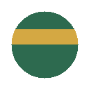

  

<h1 align="center">OogVault</h1>

A local search engine for your AI conversations.

  
  
  

  <a href="#install">Install</a> ·
  <a href="https://github.com/philippsyrov/OogVault-Desktop">OogVault Desktop</a> ·
  <a href="#contributing">Contributing</a>

**OogVault is a browser extension that saves your Claude, ChatGPT, Gemini and Perplexity conversations on your machine, makes them searchable, and suggests past answers while you type.** [OogVault Desktop](https://github.com/philippsyrov/OogVault-Desktop) is the companion app.

> [!NOTE]
> **Maintenance status:** OogVault is no longer maintained. I built it when Claude Code could only remember what was in `CLAUDE.md`. Coding agents now have proper built-in memory, so it is not needed anymore. The code still loads, but it hooks into the web pages of Claude, ChatGPT, Gemini and Perplexity, and those change often, so saving may break until the selectors are updated. Forks and PRs are welcome.

  
  

  

| Feature | What it does |
| --- | --- |
| **One-click save** | Adds a "Save to OogVault" button to `claude.ai`, `chatgpt.com` / `chat.openai.com`, `gemini.google.com` and `perplexity.ai`. |
| **Search** | Full-text keyword search across every conversation in your vault. |
| **Autocomplete** | As you type a question, matches past prompts and previews the earlier answer inline; can be turned off in Settings. |
| **Knowledge base** | Extracts Q&A nuggets from saved chats and groups them by keyword-matched topic (Finance, Science, Tech and others). |
| **Export and backup** | Exports a chat or the knowledge base as Markdown, or the whole vault as JSON that OogVault Desktop can import. |
| **Local only** | Stores everything in the browser's IndexedDB; no accounts, no telemetry, no network calls from the extension. See [docs/PRIVACY.md](docs/PRIVACY.md). |

## Install

There's no store listing. Load it unpacked. The compiled JavaScript is committed, so no build step is needed.

**Chrome, Brave or Edge**

1. Download this repository (**Code → Download ZIP**) and unzip it somewhere permanent, such as Documents. The browser needs that folder to stay put.
2. Open `chrome://extensions`.
3. Turn on **Developer mode** (top right), then click **Load unpacked**.
4. Choose the unzipped **OogVault** folder. Pin the toolbar icon from the puzzle menu.

**Firefox**

1. Open `about:debugging#/runtime/this-firefox`.
2. Click **Load Temporary Add-on…**
3. Select `manifest.json` inside your OogVault folder.

The add-on stays loaded until you quit Firefox.

## Docs

| Doc | Covers |
| --- | --- |
| [docs/ARCHITECTURE.md](docs/ARCHITECTURE.md) | Supported sites, file layout, tech stack |
| [docs/PRIVACY.md](docs/PRIVACY.md) | Where data lives, settings for export and clearing data |

## Contributing

Pull requests welcome. To add another AI platform:

1. Add `src/content/your-platform.ts`, following `src/content/claude.ts`
2. Implement `extractMessages()` with platform-specific selectors
3. Register the URL match in `manifest.json`
4. `npm install && npm run build`, then reload the extension

Saving, search, autocomplete and nuggets work automatically.

## License

MIT, see [LICENSE](LICENSE).

Built by [Philipp Syrov](https://github.com/philippsyrov). Companion app: [OogVault Desktop](https://github.com/philippsyrov/OogVault-Desktop).
